# NexusAI

NexusAI is a production-grade, modular, provider-agnostic Retrieval-Augmented Generation (RAG) document intelligence backend built with FastAPI, FAISS, Sentence-Transformers, and PyTorch. It provides end-to-end document lifecycle management, semantic vector search, deterministic query decomposition, hallucination guardrails, observability tracing, and LLM provider abstractions.

---

## Key Features

- **Multi-Format Ingestion**: Supports PDF, DOCX, TXT, and CSV document parsing.
- **Text Extraction**: Modular extraction engine preserving document metadata, line breaks, and page references.
- **Intelligent Chunking**: Sliding-window chunking engine with configurable chunk size, chunk overlap, and metadata binding.
- **Dense Vector Embeddings**: Local embedding generation using `sentence-transformers` (`all-MiniLM-L6-v2`).
- **FAISS Vector Indexing**: High-performance similarity search powered by FAISS CPU index.
- **Document Metadata Filtering**: Strict metadata and document ID scope filtering during similarity retrieval.
- **Diversity-Aware Retrieval**: Prevents single-document chunk crowding by oversampling and selecting diverse document sources in Top-K results.
- **Deterministic Query Decomposition**: Rule-based, provider-agnostic subquery breakdown for multi-part and cross-document inquiries without requiring extra LLM calls.
- **RAG Generation & Guardrails**: Relevance-threshold filtering to prevent LLM hallucinations when context is insufficient.
- **LLM Provider Abstraction**: Extensible provider interface supporting `mock`, `openai`, and `gemini` endpoints.
- **Document Lifecycle Management**: Full CRUD operations for document uploading, extraction, chunking, indexing, inspection, and FAISS vector deletion.
- **Observability & Tracing**: Per-query trace context capturing execution time breakdown across embedding, retrieval, context assembly, and LLM generation with token counts.
- **Retrieval Evaluation Framework**: Built-in evaluation framework measuring Hit@K, MRR@K, and latency percentiles.
- **Configurable CORS**: Environment-configurable cross-origin resource sharing (`ALLOWED_ORIGINS`).
- **Production Containerization**: Lightweight, security-hardened `python:3.12-slim` Docker image with container healthchecks.
- **Health Probing**: Dedicated `/health` endpoint for readiness and liveness checks.

---

## Architecture

NexusAI processes user queries and document workflows through a decoupled pipeline:

```mermaid
flowchart TD
    subgraph Ingestion ["Ingestion & Indexing Pipeline"]
        A[Document File: PDF / DOCX / TXT / CSV] --> B[Document Extractor]
        B --> C[Text Chunker: Sliding Window]
        C --> D[Embedding Service: sentence-transformers]
        D --> E[FAISS Vector Store]
    end

    subgraph RAG ["RAG Query & Retrieval Pipeline"]
        F[Client Query] --> G[Query Decomposition Engine]
        G --> H[Vector Search: FAISS]
        H --> I[Diversity Filter & Threshold Guardrail]
        I --> J[Context Builder]
        J --> K[LLM Service: OpenAI / Gemini / Mock]
        K --> L[Answer & Observability Trace Response]
    end
```



### Request Execution Flow
1. **Upload & Extract**: Documents are validated, assigned unique UUIDs, saved securely, and stripped of raw text.
2. **Chunk & Index**: Extracted text is segmented into overlapping chunks, vectorized via Sentence-Transformers, and committed to a local FAISS index.
3. **Query & Retrieve**: Incoming user prompts pass through deterministic query decomposition and vector similarity search.
4. **Filter & Assemble**: Retrieved chunks undergo document-diversity filtering and relevance-score threshold verification (`LLM_RELEVANCE_THRESHOLD`).
5. **Generate & Trace**: Validated context is injected into structured system prompts for the selected LLM provider, while performance metrics are logged to trace contexts.

---

## Retrieval Evaluation

NexusAI includes an automated retrieval benchmarking suite evaluated against a 35-question gold-standard evaluation corpus (`500` token chunk size, `50` token overlap).

> [!NOTE]
> These metrics measure **retrieval accuracy** (the system's ability to fetch exact ground-truth source chunks into Top-5 context). They evaluate vector retrieval performance and should not be confused with generative LLM factual correctness scores.

### Verified Benchmark Results (500 / 50 Configuration)

| Metric / Category | Overall | Direct Answer | Multi-Part | Cross-Document |
| :--- | :---: | :---: | :---: | :---: |
| **Sample Count** | 35 | 16 | 13 | 6 |
| **Hit@5** | **1.00** | **1.00** | **1.00** | **1.00** |
| **MRR@5** | **0.81** | **0.97** | **0.80** | **0.29** |
| **Mean Latency** | **9.90 ms** | - | - | - |
| **p95 Latency** | **14.25 ms** | - | - | - |

### Retrieval Accuracy Progression
- **Initial Baseline (Raw FAISS)**: Hit@5 = **0.87** *(suffered from single-document chunk crowding on cross-document questions)*
- **Diversity-Aware Retrieval**: Hit@5 = **0.96** *(oversampled Top-15 internal candidates and enforced multi-document diversity)*
- **Diversity + Deterministic Query Decomposition**: Hit@5 = **1.00** *(decomposed compound queries to retrieve target chunks across separate policies)*

---

## Testing

The project maintains 100% test pass rate across unit and integration test suites:

- **Total Test Count**: **161 passed**, 0 failed
- **Test Execution Speed**: ~1.5 minutes full suite run time

### Primary Test Areas
- **`test_chunking_service.py`**: Sliding window overlap boundaries, small text handling, chunk metadata.
- **`test_config.py`**: Environment variable parsing, directory resolution, CORS origin list splitting.
- **`test_cors.py`**: Cross-Origin Resource Sharing headers, OPTIONS preflight handling, origin restrictions.
- **`test_document_extractor.py`**: PDF, DOCX, TXT, CSV parsing and error handling for empty/corrupt files.
- **`test_document_lifecycle.py`**: End-to-end document upload, extraction, chunking, indexing, and deletion.
- **`test_documents.py`**: API route validation, MIME type checks, upload payload size limits.
- **`test_main.py`**: Health check route status and response payload.
- **`test_metadata_filtering.py`**: FAISS metadata filter enforcement and scope isolation.
- **`test_quality_evaluation.py`**: LLM answer evaluator formatting, metric computation, and mock responses.
- **`test_query_decomposition.py`**: Deterministic subquery extraction and subquery retrieval merging.
- **`test_rag_evaluation.py`**: Hit@K and MRR@K metric calculators and benchmark dataset loader.
- **`test_rag_observability.py`**: Trace context logging, latency breakdown, and token usage estimation.
- **`test_rag_service.py`**: Context assembly, relevance guardrail fallback, confidence classification.
- **`test_search_api.py`**: Vector search HTTP endpoint, top-K selection, and metadata constraints.
- **`test_vector_store.py`**: FAISS index initialization, persistence, search, and chunk removal.

---

## API Reference

### Health Check
- **`GET /health`**
  - **Response**: `200 OK`
    ```json
    {
      "status": "healthy",
      "service": "NexusAI"
    }
    ```

### Document Management (`/documents`)
- **`POST /documents/upload`**: Upload a new document (`multipart/form-data`).
- **`POST /documents/{document_id}/extract`**: Extract plain text from an uploaded document.
- **`POST /documents/{document_id}/chunks`**: Chunk extracted text into sliding windows.
- **`POST /documents/{document_id}/index`**: Vectorize and index chunks into FAISS.
- **`GET /documents`**: List all uploaded document metadata.
- **`GET /documents/{document_id}`**: Retrieve metadata for a specific document.
- **`DELETE /documents/{document_id}`**: Delete document file, metadata, and FAISS vectors.

### Vector Search
- **`POST /search`**
  - **Request Body**:
    ```json
    {
      "query": "What is the annual leave policy?",
      "top_k": 3,
      "document_ids": null
    }
    ```
  - **Response**: List of matching chunks with similarity scores.

### RAG Chat Query (`/chat`)
- **`POST /chat/query`**
  - **Request Body**:
    ```json
    {
      "query": "What is the gym reimbursement cap and incident isolation time?",
      "top_k": 5,
      "include_trace": false
    }
    ```
  - **Response (`200 OK`)**:
    ```json
    {
      "answer": "The gym reimbursement cap is $50 per month, and the incident response isolation time is 15 minutes.",
      "sources": [
        {
          "source_filename": "benefits_policy.pdf",
          "page": 1,
          "chunk_id": "doc1_chunk0",
          "score": 0.82
        },
        {
          "source_filename": "security_policy.pdf",
          "page": 2,
          "chunk_id": "doc2_chunk1",
          "score": 0.79
        }
      ],
      "confidence": "high"
    }
    ```

---

## Configuration

NexusAI uses environment-based configuration via `pydantic-settings`. Configure options in `.env` (derived from `.env.example`):

| Variable | Default Value | Description |
| :--- | :--- | :--- |
| `APP_NAME` | `NexusAI` | Name of the application |
| `ENVIRONMENT` | `development` | Environment mode (`development`, `production`) |
| `DEBUG` | `true` | Enable debug logs and trace output |
| `ALLOWED_ORIGINS` | `http://localhost:3000,...` | Comma-separated list of allowed browser origins |
| `LLM_PROVIDER` | `mock` | LLM provider backend (`mock`, `openai`, `gemini`) |
| `LLM_MODEL` | `gpt-4o-mini` | LLM model identifier |
| `LLM_API_KEY` | `""` | API key for LLM provider (keep blank for `mock`) |
| `LLM_API_URL` | `https://api.openai.com/v1/chat/completions` | Provider API endpoint URL |
| `LLM_TEMPERATURE` | `0.0` | Temperature setting for LLM sampling |
| `LLM_RELEVANCE_THRESHOLD` | `0.4` | Minimum vector similarity score to invoke LLM |
| `LLM_HIGH_CONFIDENCE_THRESHOLD` | `0.6` | Score threshold for high-confidence categorization |
| `CHUNK_SIZE` | `500` | Token/character size per text chunk |
| `CHUNK_OVERLAP` | `50` | Overlap size between adjacent chunks |
| `EMBEDDING_MODEL` | `all-MiniLM-L6-v2` | Sentence-Transformers embedding model name |
| `UPLOAD_DIR` | `data/raw` | Local storage directory for raw uploaded files |
| `VECTOR_STORE_DIR` | `data/vector_store` | Local storage directory for FAISS index files |
| `LOGS_DIR` | `logs` | Directory for observability trace logs |
| `GEMINI_API_KEY` | `""` | Optional API key for Google Gemini model calls |

---

## Local Development

### 1. Environment Setup
```bash
# Create virtual environment
python -m venv .venv

# Activate environment (Windows PowerShell)
.venv\Scripts\Activate.ps1

# Activate environment (macOS / Linux)
source .venv/bin/activate
```

### 2. Install Dependencies
```bash
python -m pip install --upgrade pip
pip install -r requirements.txt
```

### 3. Run Test Suite
```bash
pytest
```

### 4. Start Development Server
```bash
uvicorn app.main:app --reload --host 0.0.0.0 --port 8000
```
- API Base URL: `http://localhost:8000`
- Swagger UI Documentation: `http://localhost:8000/docs`
- ReDoc Documentation: `http://localhost:8000/redoc`

---

## Docker Containerization

NexusAI is packaged as a production-ready container image using a Debian-slim base image with Linux OpenMP (`libgomp1`) support for FAISS CPU execution.

### Build Image Locally
```bash
docker build -t nexusai:latest .
```

### Run Container Locally
```bash
docker run -d --name nexusai_container -p 8000:8000 nexusai:latest
```

### Verify Container Health
```bash
curl http://localhost:8000/health
```

### Stop & Remove Container
```bash
docker stop nexusai_container
docker rm nexusai_container
```

---

## Project Structure

```text
NexusAI/
├── .dockerignore           # Excludes runtime data, caches, and environment files
├── .env.example            # Environment configuration template
├── .gitignore              # Repository file exclusion rules
├── Dockerfile              # Production Python 3.12 container specification
├── README.md               # Project documentation
├── requirements.txt        # Python dependency manifest
├── app/
│   ├── __init__.py
│   ├── main.py             # FastAPI entrypoint & middleware registration
│   ├── config.py           # Application settings & environment loader
│   ├── api/
│   │   ├── chat.py         # /chat query endpoint handlers
│   │   └── documents.py    # /documents management & /search endpoints
│   ├── evaluation/
│   │   ├── dataset.json    # Evaluation benchmark query corpus
│   │   ├── evaluator.py    # LLM quality evaluation implementation
│   │   ├── metrics.py      # Hit@K and MRR@K evaluation metric engines
│   │   ├── run.py          # Benchmark execution entrypoint
│   │   └── run_quality.py  # Answer quality benchmark runner
│   └── services/
│       ├── chunking_service.py          # Sliding window text chunker
│       ├── context_builder.py           # Context formatting for prompts
│       ├── document_extractor.py        # PDF/DOCX/TXT/CSV parsers
│       ├── document_service.py          # Storage and file validation
│       ├── embedding_service.py         # Sentence-Transformers manager
│       ├── indexing_service.py          # Document chunk indexing orchestrator
│       ├── llm_service.py               # OpenAI / Gemini / Mock LLM wrapper
│       ├── metadata_service.py          # JSON metadata persistence
│       ├── query_decomposition_service.py # Subquery decomposition engine
│       ├── tracing_service.py           # Execution trace logger
│       └── vector_store.py              # FAISS index wrapper & diversity filter
└── tests/
    ├── test_chunking_service.py
    ├── test_config.py
    ├── test_cors.py
    ├── test_document_extractor.py
    ├── test_document_lifecycle.py
    ├── test_documents.py
    ├── test_main.py
    ├── test_metadata_filtering.py
    ├── test_quality_evaluation.py
    ├── test_query_decomposition.py
    ├── test_rag_evaluation.py
    ├── test_rag_observability.py
    ├── test_rag_service.py
    ├── test_search_api.py
    └── test_vector_store.py
```

---

## Security & Privacy

- **Zero Embedded Secrets**: No API keys, passwords, or credentials are hardcoded into source code or committed to Docker images.
- **Environment Isolation**: `.env` and `.venv/` files are strictly ignored by `.gitignore` and `.dockerignore`.
- **Runtime Data Isolation**: Uploaded files (`data/raw/`), vector store indices (`data/vector_store/`), and execution logs (`logs/`) are excluded from repository commits.
- **Trace Redaction**: Log preview toggles (`LOG_QUERY_PREVIEWS`) prevent sensitive query content from persisting in trace logs when disabled.

---

## Limitations & Scope

- **Deployment Scope**: Local containerization and local execution verified; cloud infrastructure deployment (AWS/GCP/Kubernetes) is outside current scope.
- **Authentication**: Authentication and RBAC layers are not included (intended for deployment behind an API Gateway or reverse proxy).
- **Storage Persistence**: Vector store indices and uploaded document metadata reside on local filesystem mounts.
- **Upstream Rate Limits**: Production OpenAI and Gemini calls depend on third-party API quotas and tier limits.
- **Metric Scope**: Benchmark metrics measure vector context retrieval performance against target chunks rather than end-to-end generative LLM output factual correctness.
